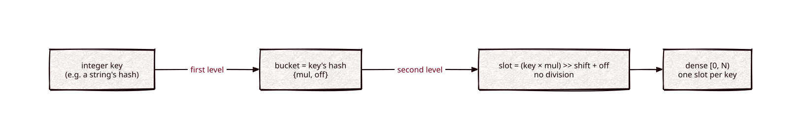

# constexpr-phf

Part of [Kronuz C++ Libraries](https://github.com/Kronuz/cpp-libraries), a collection of small, reusable C++ libraries.

[](https://github.com/Kronuz/constexpr-phf/actions/workflows/ci.yml)
[](LICENSE)


A minimal perfect hash for C++17, built entirely at compile time: a fixed set
of integer keys maps onto a dense `[0, N)` with no collisions, so dispatching on
a key is one array index or a real jump table. For keyword tables, protocol
opcodes, and any `switch` on hashed strings.



## ✨ Highlights

- **Flat, fast lookups.** About 1.2 ns whether the set has 6 keys or 1,000; at
  1,000 keys an `if` ladder takes 162 ns and a `switch` 40 ns
  ([docs/BENCHMARKS.md](docs/BENCHMARKS.md), x86_64, GCC 11).
- **Built by the compiler.** The search for a collision-free hash runs in
  `constexpr`, leaving only two small arrays behind; no heap, no I/O.
- **Real jump tables.** Every `find()` of a known key is a compile-time constant,
  so it works as a `case` label.
- **No division.** Lookups use multiply-shift into a power-of-two table, with a
  robust pre-mixed fallback chosen at compile time for adversarial keys.
- **Fast string dispatch.** With a string hash in front, it beats
  `std::unordered_map`, `frozen`, and a compile-time trie, and trails only gperf,
  which needs a code generator.

## 📦 Installation

Requires a C++17 compiler; CMake 3.14 or newer for the CMake route. CI builds it
on Linux (x86_64, arm64), macOS (arm64, x86_64), and FreeBSD, plus ASan, UBSan,
and TSan builds.

```cmake
include(FetchContent)
FetchContent_Declare(constexpr_phf
  GIT_REPOSITORY https://github.com/Kronuz/constexpr-phf.git
  GIT_TAG        master)
FetchContent_MakeAvailable(constexpr_phf)

target_link_libraries(my_app PRIVATE constexpr_phf::constexpr_phf)
```

Or copy `phf.hh` onto your include path.

## 🚀 Quick start

A string `switch` that compiles to a jump table. `hash` is any `constexpr` string
hash you choose:

```cpp
#include "phf.hh"

#include <string_view>

static constexpr auto ops = phf::make_phf({hash("add"), hash("remove"), hash("move")});

int dispatch(std::string_view op) {
	switch (ops.find(hash(op))) {
		case ops.find(hash("add")):    return do_add();
		case ops.find(hash("remove")): return do_remove();
		case ops.find(hash("move")):   return do_move();
		default:                       return unknown(op);
	}
}
```

A perfect hash only separates the keys it was built from: for input that may not
be a member, compare against the key at the slot. `find` returns `phf::npos` for a
non-key, `at` throws. [`examples/demo.cc`](examples/demo.cc) shows parallel
tables and the verified pattern.

## 🎯 When to use it

- ✅ A fixed set of integer keys known at build time, looked up often.
- ✅ String dispatch, with a hash in front and a verify step for open input.
- ❌ Keys that change at runtime: there is no insert or erase.
- ❌ Very large key sets: the search runs at compile time and costs build time.

## 📚 Documentation

- [docs/API.md](docs/API.md): `make_phf`, the members, integer keys and strings,
  and when not to use it.
- [ARCHITECTURE.md](ARCHITECTURE.md): the data layout, the lookup formula, the
  pre-mix, and the adaptive build.
- [docs/BENCHMARKS.md](docs/BENCHMARKS.md): the integer core, the comparison with
  `if` ladders, `switch`, and `unordered_map`, and string dispatch against gperf,
  frozen, and a trie.
- [AGENTS.md](AGENTS.md): repository map, invariants, and traps.

## 🛠️ Building and testing

```sh
cmake -B build && cmake --build build && ctest --test-dir build
./build/phf_demo
./build/phf_compare
```

The dispatch benchmarks fetch `ctrie` and `frozen`; the gperf tables are
committed under `bench/`.

## 🤝 Contributing

Issues and pull requests are welcome. Read [AGENTS.md](AGENTS.md) first. CI must
pass on every platform.

## 📄 License

MIT, Copyright (c) 2018-2026 Germán Méndez Bravo. See [LICENSE](LICENSE).
